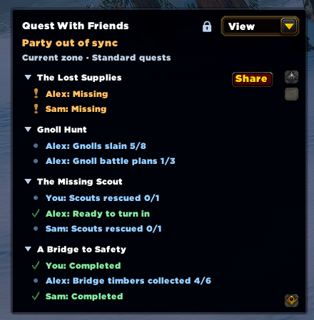

# Quest With Friends

**Know when everyone is ready to move on.**

  

Quest With Friends shows the differences that matter while questing together: who missed a quest, who still needs an objective, and who is ready to turn in. When your party is caught up, it says **Party in sync**.

Built for **World of Warcraft Retail** and **WoW Forever**. The addon is self-contained and works alongside Blizzard's quest tracker. Everyone in the party needs the addon to share their progress.

## Why use it?

- **Catch missed quests before leaving town.** See which friends are missing a quest, with a **Share** button when WoW allows you to offer it.
- **Avoid leaving someone behind.** See remaining objectives when another party member has finished, with readiness and completion differences grouped under one quest title.
- **Put spare quest items to use.** For identifiable tradeable item objectives, finished members can show counts such as **10/10 · 2 spare** while a friend still needs items. Spare counts exclude items needed for the player's own logged quests and bank stock. Confirmed spares remain visible after turning in a quest during the current session; old completion history alone cannot identify spare items.
- **Keep the view relevant.** Focus on the current zone and optionally include profession or class quests. On Forever, Camping quests count as profession quests too.
- **See connection health at a glance.** Notices distinguish offline members from waiting, refreshing, stale, or incompatible data. Last-known differences stay visible during recovery.

## Get started

1. Install Quest With Friends for your client. For manual installation, download `QuestWithFriends-<version>.zip` from [GitHub Releases](https://github.com/adampoit/quest-with-friends/releases) and extract it so the addon manifest is at `Interface/AddOns/QuestWithFriends/QuestWithFriends.toc`.
2. Enable **Quest With Friends** in the character-selection AddOns menu, then log in or `/reload`.
3. Have your friends install the same release, then join a party. The panel appears and updates automatically as you quest.

Install a separate copy in each client if you play both Retail and Forever.

Optional PTR compatibility previews, when available, are listed as prereleases on [GitHub Releases](https://github.com/adampoit/quest-with-friends/releases). These are experimental downloads for the client version named in their notes, not updates for live players. CurseForge and Wago carry stable releases only.

**Try it solo:** use `/qwf preview`, or enable **Preview appearance** in the addon's settings, to explore sample party data and arrange the panel. Sharing is disabled in preview. Click **End preview** or use `/qwf preview off` to stop; joining a group or reloading also ends it.

## How it works

The panel highlights **missing quests**, **unfinished objectives**, and **ready-to-turn-in or completed quests** when party members differ. Comparisons include differences between your friends, even when you are missing or still working on the quest yourself.

Click **Share** beside a quest to offer it through WoW's normal party-wide sharing flow. WoW checks eligibility, and recipients accept the offer. Right-click a quest heading and choose **Abandon quest…** to open WoW's confirmation, including its quest-item removal warning when applicable. This action is available only for abandonable quests in your own log and is disabled for sample data. Most comparisons use exact quest IDs; a small set of reviewed Retail Northshire quest variants also compare across class and race versions.

### Focus the view

Open **View** in the panel header to choose:

- **Current zone only** — on by default.
- **Show profession quests** and **Show class quests** — off by default.
- **Smart** sorting — missing quests first, then most recent quest activity within each group — or **Title A–Z**.
- **Objective progress:** **When anyone finishes** (default), **When I finish**, or **Always**.

**When I finish** shows objective counts, including your own, only after you finish that particular objective; missing/readiness/completion notices stay visible. Before then, hide those objective rows entirely rather than substituting **Still in progress**. **Always** shows everyone's known counts on shared objectives while anyone still needs progress, even when nobody has finished or everyone has equal counts. Fully finished objectives stay quiet.

**Party in sync** reflects your filters, quest ignores and selected objective-progress mode. Informational counts in Always do not create differences. In When I finish, hidden objective rows do not count toward party status; independent quest-state differences still do. Click a quest heading to collapse or expand its details; collapsed quests still count toward party status. Long lists scroll.

### Start fresh with a party

When you join a party or someone joins yours, a popup offers to ignore existing missing-quest differences once available quest data arrives. It includes **all zones and quest types**, even those hidden by your filters, but preserves objective and readiness comparisons on shared quests. New pickups still appear normally. Unknown members are never assumed to be missing quests.

Right-click a heading and choose **Ignore quest** to hide that quest's differences, or use **View → Ignore current missing quests** for a bulk action. **Undo** reverses the latest ignore action. Open **View → Ignored quests** to restore individual quests or **Restore all**; this view always includes every zone and quest type.

Ignores affect only your view and last until **you leave the party**. They survive UI reloads, disconnects, and other members leaving. A quest resurfaces if an originally missing player picks it up. Ignores for shared progress stay until restored or you leave. In addon settings, **Existing quests when the party changes** lets you choose **Ask what to ignore** (default), **Automatically ignore existing missing quests**, or **Keep showing all differences**. Automatic ignoring applies only to the group-change baseline, not to later pickups.

### Arrange the panel

Click the lock icon beside **View** to unlock the panel. Drag the header to move it and the bottom-right corner to resize it, then lock it again. The locked panel shrinks to fit its content, scrolling when needed. Layout, filters, sorting, objective-progress mode, and collapse choices are saved across reloads and characters.

The panel hides when you leave the party. Use `/qwf` to request a fresh party comparison if something looks out of date. **Party status incomplete** means a member is offline or the addon is waiting for fresh, compatible data—not that everyone is caught up.

## Feedback and links

[Report a problem on GitHub](https://github.com/adampoit/quest-with-friends/issues) with your client (Retail or Forever), addon version, and reproduction steps. For sync issues, mention whether everyone used the same release and whether `/qwf` helped. Redact player identities from screenshots and keep account files and SavedVariables private.

- [Changelog](https://github.com/adampoit/quest-with-friends/blob/main/CHANGELOG.md)
- [Development and releases](https://github.com/adampoit/quest-with-friends/blob/main/DEVELOPING.md)
- [Quest-data sources and tooling](https://github.com/adampoit/quest-with-friends/blob/main/tools/README.md)

Original code and documentation are [MIT licensed](https://github.com/adampoit/quest-with-friends/blob/main/LICENSE). Quest data uses ATT and QuestieDB.
